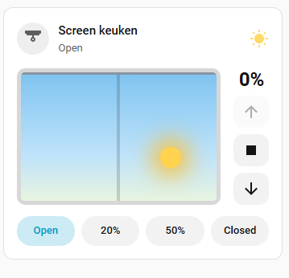

[🇬🇧 English](https://github.com/jodewee/solar-screen-card/blob/main/README.md) · [🇳🇱 Nederlands](https://github.com/jodewee/solar-screen-card/blob/main/README.nl.md) · [🇫🇷 Français](https://github.com/jodewee/solar-screen-card/blob/main/README.fr.md) · [🇩🇪 Deutsch](https://github.com/jodewee/solar-screen-card/blob/main/README.de.md) · [🇵🇱 Polski](https://github.com/jodewee/solar-screen-card/blob/main/README.pl.md) · [🇸🇪 Svenska](https://github.com/jodewee/solar-screen-card/blob/main/README.sv.md) · [🇩🇰 Dansk](https://github.com/jodewee/solar-screen-card/blob/main/README.da.md) · **🇳🇴 Norsk** · [🇪🇸 Español](https://github.com/jodewee/solar-screen-card/blob/main/README.es.md) · [🇮🇹 Italiano](https://github.com/jodewee/solar-screen-card/blob/main/README.it.md)

# Solar Screen Card

Et Lovelace-kort for Home Assistant for å styre solskjermer/screens (og andre rullegardiner/markiser, `cover.*`).



- **Visuelt vindu**: duken følger den faktiske posisjonen.
- **Dra**: dra i vinduet til ønsket høyde, slipp = `cover.set_cover_position`.
- **Knapper**: opp / stopp / ned (bare aktive hvis coveren din støtter det).
- **Hurtigknapper**: valgfrie posisjoner (f.eks. Åpen, 50 %, Lukket).
- **Solindikator**: dag-/natthimmel via `sun.sun`; med vinduets retning viser kortet når solen faktisk skinner på det.
- **Ekstra sensorer**: f.eks. lux, innetemperatur eller vind som brikker nederst.
- Visuell editor, klar for seksjonsvisningen, følger HA-temaet ditt, tilgjengelig på 10 språk.

## Installasjon

### Marketplace / HACS (anbefalt)
1. Åpne **Innstillinger → Marketplace** (eller HACS i eldre versjoner).
2. Søk etter **Solar Screen Card**.
3. Installer kortet og last inn nettleseren på nytt.

### Marketplace / HACS: egendefinert repository (reserveløsning)
Finner du ikke kortet via søk (f.eks. fordi det ikke er i katalogen ennå)? Legg da til repositoryet selv:
1. Åpne **Innstillinger → Marketplace** (eller HACS) → **Legg til via lenke / Egendefinerte repositories**.
2. Legg til `https://github.com/jodewee/solar-screen-card` med typen **Dashboard / Lovelace**.
3. Installer **Solar Screen Card** og last inn nettleseren på nytt.

### Manuelt
1. Kopier `solar-screen-card.js` til `/config/www/`.
2. Legg til en ressurs (**Innstillinger → Dashbord → ⋮ → Ressurser**):
   `/local/solar-screen-card.js?v=2026.11.17.2`, type **JavaScript-modul**.

## Konfigurasjon

```yaml
type: custom:solar-screen-card
entity: cover.screen_kjokken
name: Screen kjøkken
moving_entity: sensor.screen_kjokken_moving   # valgfri
window_azimuth: 180        # vinduet vender mot sør
window_fov: 100            # solen regnes som "på vinduet" innenfor ±50°
percent_mode: closed       # vis "% lukket" i stedet for "% åpen"
presets: [100, 50, 20, 0]
info_entities:
  - sensor.lux_ute
  - entity: sensor.temperatur_kjokken
    name: Inne
```

| Innstilling | Standard | Beskrivelse |
|---|---|---|
| `entity` | **påkrevd** | Skjermens `cover`-entitet |
| `name` | friendly name | Navn øverst |
| `icon` | `mdi:blinds` | Eget ikon |
| `moving_entity` | – | Sensor som melder bevegelse (`up`/`down`/`opening`/`closing`), f.eks. fra Zigbee2MQTT |
| `presets` | `[0, 50, 100]` | Hurtigknapper som posisjon i % åpen (HA-konvensjon: 100 = åpen) |
| `percent_mode` | `open` | `open` eller `closed`: hvordan prosenten vises |
| `step` | `5` | Avrunding i % ved draging |
| `show_sun` | `true` | Vis himmel og sol |
| `sun_entity` | `sun.sun` | Sol-entitet |
| `window_azimuth` | – | Retningen vinduet vender mot (N=0, Ø=90, S=180, V=270) |
| `window_fov` | `90` | Bredde i grader der solen skinner på vinduet |
| `info_entities` | – | Liste med ekstra sensorer (tekst eller `{entity, name, icon}`) |
| `window_background` | `sky` | Hva du ser gjennom vinduet: `sky` (himmel, dag/natt), `color` (ensfarget), `image` (foto) eller `transparent` (kortets bakgrunn) |
| `window_color` | – | Farge bak glasset med `window_background: color`: `[r, g, b]` eller CSS-farge |
| `window_image` | – | Foto bak glasset med `window_background: image` (last opp via editoren) |
| `window_image_url` | – | Eller en URL til bildet, f.eks. `/local/hage.jpg` (har forrang foran `window_image`) |
| `window_opacity` | `100` | Dekkevne for himmel/utsikt i % (0 = du ser kortets bakgrunn gjennom glasset) |
| `window_night_dim` | `true` | Gjør egen farge/eget bilde mørkere når solen har gått ned |
| `background_color` | tema | Bakgrunnsfarge: `[r, g, b]` eller en CSS-farge (`"#20303a"`) |
| `background_image` | – | Bilde: last opp via editoren, eller en URL som `/local/screen.jpg` |
| `background_opacity` | `100` | Bakgrunnens dekkevne i % (0 = gjennomsiktig). Innholdet forblir fullt synlig |
| `background_blur` | `0` | Uskarphet (px) for det som ligger bak kortet, for en "glass"-effekt |

### Vindusbakgrunn

I den visuelle editoren er seksjonen **Vindusbakgrunn** åpen som standard. Velg under **Hva ser du gjennom vinduet?**:

- **Himmel (standard)**: blå himmel om dagen, mørk himmel om natten (med `show_sun`).
- **Ensfarget**: en fargevelger vises.
- **Foto / bilde**: last opp et bilde (f.eks. den ekte utsikten din) eller skriv inn en URL som `/local/hage.jpg`.
- **Gjennomsiktig**: du ser kortets bakgrunn gjennom glasset.

Med farge eller foto stiller du også inn dekkevnen og om det skal gjøres mørkere om natten. Solen skinner (valgfritt) fortsatt over.

```yaml
window_background: image
window_image_url: /local/utsikt_kjokken.jpg
window_opacity: 90
window_night_dim: true
```

Eldre konfigurasjoner med bare `window_color` eller `window_image` fungerer fortsatt: kortet velger selv riktig modus.

### Kortbakgrunn

I editoren finner du alt under **Kortbakgrunn**: velg en farge, last opp et bilde, og still inn dekkevne og uskarphet.

```yaml
# Gjennomsiktig "glass"-kort
background_opacity: 30
background_blur: 8

# Eget bilde som bakgrunn
background_image: /local/kjokken.jpg
background_opacity: 60
```

Farger kan endres via temavariabler: `--ssc-fabric`, `--ssc-bar`, `--ssc-frame`.

## Språk

Kortet og den visuelle editoren følger språket i Home Assistant: engelsk, nederlandsk, fransk, tysk, polsk, svensk, dansk, norsk (bokmål), spansk og italiensk. Andre språk faller tilbake til engelsk. Forbedringer av en oversettelse er velkomne via en pull request.

## Lisens
MIT
